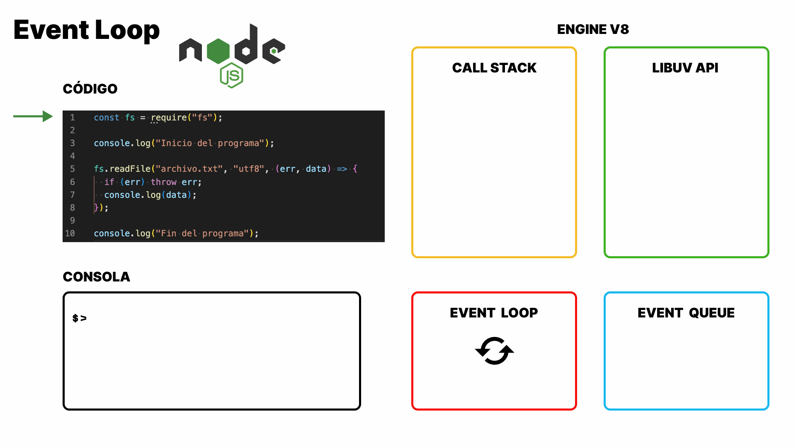

# Node.js

Node.js no es un lenguaje de programación ni un framework, sino un entorno de ejecución (runtime) de código abierto construido sobre el motor de JavaScript V8 de Google (el mismo que utilizan los navegadores modernos).

Su principal innovación fue permitir que JavaScript saliera del navegador web para ejecutarse directamente en el sistema operativo del servidor o en tu máquina local. Esto permite utilizar un solo lenguaje de programación tanto para la interfaz de usuario **(frontend)** como para la lógica del servidor **(backend)**.

### NVM (Node Version Manager)

NVM (Node Version Manager) es una herramienta de línea de comandos que permite instalar, gestionar y cambiar entre múltiples versiones de Node.js en una misma máquina de forma limpia y sin conflictos de permisos.

#### ¿Por qué utilizar NVM en lugar del instalador tradicional standalone?

- _Flexibilidad de versiones_ : Diferentes proyectos pueden requerir versiones específicas de Node.js (por ejemplo, una aplicación antigua que corre en la versión 16 y un proyecto moderno en la versión 20 o superior). Con NVM puedes alternar entre ellas con un simple comando.

* _Control de permisos_: La instalación tradicional (Stand Alone) a menudo requiere permisos de administrador (sudo en sistemas Unix), lo que puede generar problemas de seguridad o permisos al instalar paquetes globales con NPM. NVM instala Node.js en un directorio exclusivo del usuario.

```bash
# Instalar una versión específica
nvm install 20.11.0

# Listar versiones instaladas
nvm ls

# Usar una versión en la terminal actual
nvm use 18.16.0

# Establecer una versión predeterminada por defecto
nvm alias default 20.11.0
```

### REPL

REPL son las siglas en inglés de Read, Eval, Print, Loop (Leer, Evaluar, Imprimir y Bucle). Se trata de un entorno interactivo (una consola equivalente a console en el navegador) que viene integrado por defecto con Node.js y te permite ejecutar código JavaScript de manera inmediata sin necesidad de crear un archivo .js.

Para abrir el REPL, simplemente escribe el siguiente comando en tu terminal: `node`. Una vez dentro, verás que el cursor cambia a >. Ahí puedes escribir cualquier instrucción de JavaScript: `5 + 5`.

### Single-Thread

A diferencia de otros lenguajes de backend tradicionales (como Java, PHP o C#) que utilizan un modelo multihilo (donde cada petición de un cliente abre un hilo de ejecución independiente en el procesador), Node.js opera en un único hilo principal (Single-Threaded).

Eficiencia: Al no gastar recursos abriendo un hilo nuevo por cada usuario conectado (lo que consume mucha memoria RAM y capacidad de cómputo en cambios de contexto), este modelo permite escalar y manejar una concurrencia masiva de forma sumamente eficiente.

### Evetn Loop

</img>

El Event Loop es el mecanismo central que permite a Node.js realizar operaciones no bloqueantes a pesar de ser de un solo hilo (single-threaded).

¿Cómo opera? Cuando ejecutas código asíncrono (como leer un archivo o hacer una petición de red), Node.js delega la tarea al sistema operativo o al pool de hilos de **libuv** y continúa ejecutando el resto de tu código de forma inmediata.

#### libuv

Libuv es una biblioteca de soporte escrita en lenguaje C, diseñada originalmente para Node.js, cuyo propósito principal es proporcionar un modelo de E/S (Entrada/Salida) asíncrono y no bloqueante. Es el equivalente a las Web APIs nativas en el navegador, pero para el back-end.

### Módulos en Node.js

Para mantener el código organizado, mantenible y escalable, Node.js divide las aplicaciones en archivos independientes llamados módulos. Cada archivo en Node.js se trata como un módulo separado de forma predeterminada (_como si fuera una pieza de LEGO_), aislando sus variables y funciones a menos que se exporten explícitamente.

❌ 1 archivo con 1000 lineas de código.

✅ todo el código distribuido en dferentes archivos.

Existen 2 tipos de módulos:

- **Core Modules o Nativos**: Vienen instalados por defecto con Node.js, por lo que no necesitas instalar nada adicional a través de NPM. Están escritos en C++ y JavaScript optimizado para ofrecer un rendimiento de bajo nivel muy alto. Ejemplos populares:
  - `fs` (File System): Para leer, escribir, modificar y eliminar archivos y carpetas del disco duro.
  - `path`: Para gestionar rutas de archivos y directorios de forma multiplataforma.
  - `http`: Para crear servidores web y gestionar peticiones de red.
  - `os`: Para obtener información del sistema operativo y hardware.
- **Módulos Personalizados**: Son aquellos que creamos nosotros mismos en nuestros proyectos o que descargamos de terceros para extender la funcionalidad de la aplicación.
  - _Módulos de NPM (Node Package Manager)_
  - _Módulos Propios (o locales)_

Históricamente y en la actualidad, Node.js soporta principalmente dos estándares de modularización:

#### CommonJS (CJS)

Es el sistema de módulos tradicional y nativo histórico de Node.js. Utiliza la función `require()` para importar dependencias y `module.exports` o exports para exponerlas.

Su carga es síncrona (se cargan los módulos en tiempo de ejecución conforme se van leyendo).

```javaScript
// Exportar elementos
module.exports = { sumar, restar };

// Importar un módulo
const miModulo = require('./miModulo');
```

#### ES Modules (ESM)

Es el estándar oficial de JavaScript moderno (el mismo que se usa en los navegadores).Utiliza las palabras clave `import` y `export`.

Su carga es asíncrona por diseño.

Para habilitar ES Modules en Node.js, puedes agregar `"type": "module"` en tu archivo package.json o utilizar la extensión `.mjs` en tus archivos.

```javascript
// Exportar elementos
export const multiplicar = (a, b) => a * b;

// Importar un módulo
import { sumar, restar } from "./miModulo.js";
```

### NPM (Node Package Manager)

#### `package.json`

Es el **cerebro y pasaporte de tu proyecto**. Funciona como un archivo de manifiesto en formato JSON que almacena la metadatos esencial de tu aplicación (como el nombre, versión y descripción).

Su función principal es administrar las dependencias y los scripts. Aquí se registran de forma organizada todas las librerías externas que tu proyecto necesita para funcionar, junto con comandos personalizados para ejecutar, probar o construir tu código.

#### **`package-lock.json`**

Es el **historial de versiones exactas e inmutables** de tu proyecto. Se genera de forma automática al instalar librerías y guarda un mapa detallado y milimétrico (incluyendo versiones y subdependencias) de todo lo que se instaló.

Su propósito fundamental es garantizar que cualquier persona que descargue tu código o lo suba a un servidor obtenga exactamente las mismas versiones de los paquetes, evitando fallos o incompatibilidades imprevistas.

#### **`node_modules`**

Es la **carpeta que almacena físicamente todo el código fuente** de las librerías y dependencias que vas instalando a través de NPM. Contiene miles de archivos pequeños correspondientes a los paquetes descargados para tu proyecto.

Es una carpeta sumamente pesada que **nunca debe subirse a Git ni compartirse**, ya que puede reconstruirse de manera automática e inmediata en cualquier computadora con solo ejecutar el comando `npm install` utilizando la información guardada en tu `package.json` y `package-lock.json`.
